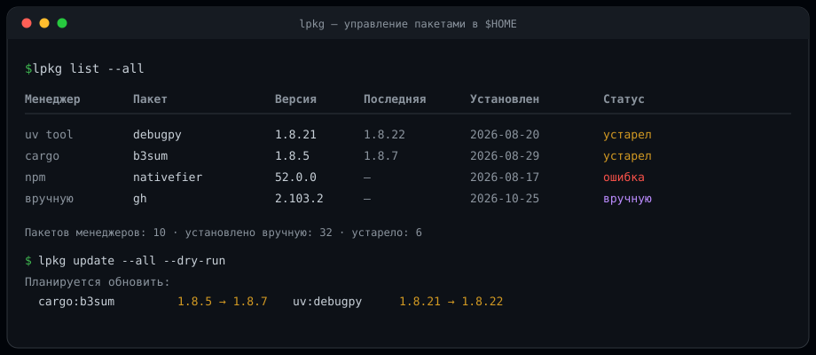

<p align="center">
  
</p>

<h1 align="center">lpkg</h1>

<p align="center">
  Единая точка управления пакетами, которые менеджеры ставят в <code>$HOME</code>.
</p>

<p align="center">
  <a href="https://github.com/grivital/lpkg/actions/workflows/tests.yml"></a>
  
  
  
  
</p>

---

## Проблема

Софт в домашнем каталоге ставят как минимум семь разных систем: `uv tool`,
`cargo install`, `npm -g`, `gem`, `pip --user`, `go install` и
`flatpak --user`. Каждая хранит свои метаданные по-своему, а часть вообще
ничего не хранит. В результате невозможно ответить на простые вопросы:

- что у меня установлено и кем;
- когда это появилось;
- что можно обновить;
- почему `nativefier` есть, а `npm` его не видит;
- какой из двух `foo` в `PATH` запустится на самом деле.

`lpkg` отвечает на них из одной команды и умеет обновлять всё оптом —
родными командами каждого менеджера, без ручного вмешательства.

## Возможности

- **Одна таблица** для семи менеджеров и установленного вручную.
- **Кто, когда и куда**: менеджер, версия, каталог, бинари, приблизительное время установки.
- **Проверка обновлений** через родные механизмы каждого менеджера.
- **Обновление оптом**: `lpkg update --all`, с `--dry-run` и подтверждением.
- **Сканер сирот**: находит бинари вне менеджеров, битые симлинки, дубликаты команд и расхождения каталогов (`lib` против `lib64` у npm).
- **Go-бинари** распознаются по встроенной buildinfo: модуль и версия читаются прямо из ELF.
- **JSON** у всех команд — для скриптов, cron и мониторинга.
- **TUI** на `dialog` для тех, кто предпочитает меню.
- **Ноль внешних зависимостей**: только стандартная библиотека Python.

## Установка

### Через Portage

В репозитории есть `Makefile` с поддержкой `DESTDIR` и заготовка ebuild:

```bash
# из локального оверлея
emerge app-admin/lpkg
```

Если оверлея нет, скопируйте `contrib/gentoo/app-admin/lpkg` в свой оверлей
и создайте `Manifest`:

```bash
cd /var/db/repos/ваш-оверлей/app-admin/lpkg
ebuild lpkg-0.1.2.ebuild manifest
```

Подробности — в разделе [«Установка через Portage»](#установка-через-portage-1).

### Через Makefile

По умолчанию установка идёт в `/opt`:

```bash
make install                 # /opt/bin/lpkg, /opt/lib/pythonX.Y/site-packages/lpkg
make install PREFIX="$HOME/.local"
make uninstall
```

Для `/opt` нужны права на запись. Скрипт `lpkg` при запуске сам добавляет
`<prefix>/lib/pythonX.Y/site-packages` в `sys.path`, поэтому `PYTHONPATH` и
другие переменные окружения не требуются.

### Через pip или uv

```bash
pip install --user .
# или
uv tool install .
```

### Без установки

```bash
git clone https://github.com/grivital/lpkg.git
cd lpkg
python -m lpkg --help
```

Требуется Python 3.11 или новее. Внешних зависимостей нет.

## Быстрый старт

```bash
lpkg list                  # что установлено
lpkg outdated              # что можно обновить
lpkg update --all --dry-run  # точные команды, ничего не выполняя
lpkg update --all          # обновить всё устаревшее
lpkg doctor                # сироты, битые ссылки, дубликаты
```

## Поддерживаемые менеджеры

| Источник | Откуда берутся данные | Обновление |
|---|---|---|
| `uv tool` | `uv tool list --show-paths`, `uv-receipt.toml` | `uv tool upgrade` |
| `cargo install` | `$CARGO_HOME/.crates2.json`, `.crates.toml` | `cargo install-update` |
| `npm -g` | `lib/node_modules`, `lib64/node_modules`, `package.json` | `npm update -g` / `npm install -g @latest` |
| `gem` | `gem list` в пользовательском `GEM_HOME` | `gem update` |
| `pip --user` | `pip list --user --format=json` | `pip install --upgrade` |
| `go install` | buildinfo из бинарей в `GOBIN` (`go version -m`) | `go install module@latest` |
| `flatpak --user` | `flatpak list --user --json` | `flatpak update --user` |
| «вручную» | сканирование bin-каталогов | не обновляется |

Сканер дополнительно проверяет `~/.local/bin`, `~/bin`, `~/.cargo/bin`,
`~/.npm/bin`, `~/go/bin` и каталоги из конфигурации.

## Команды

### Просмотр

```bash
lpkg list                       # всё, что ставят менеджеры
lpkg list --all                 # плюс установленное вручную
lpkg list --check               # с проверкой обновлений (сеть)
lpkg list --outdated            # только устаревшие (проверка включается сама)
lpkg list --manager cargo       # фильтр по менеджеру
lpkg list --paths --json        # пути к бинарям, машинный формат
lpkg info gh                    # подробности о пакете
lpkg diff                       # изменения с прошлого скана
lpkg history                    # журнал операций lpkg
lpkg export -o snapshot.json    # снимок для инвентаризации
```

### Обновление

```bash
lpkg outdated                   # список доступных обновлений
lpkg update --all --dry-run     # показать точные команды
lpkg update --all               # обновить всё устаревшее (спросит подтверждение)
lpkg update --all --latest      # разрешить мажорные обновления (npm, uv)
lpkg update --all -y            # без подтверждения (для cron)
lpkg update cargo:b3sum uv:debugpy
```

### Установка и удаление

```bash
lpkg install uv:ruff
lpkg install npm:@scope/pkg
lpkg install go:github.com/cli/cli/v2/cmd/gh@latest
lpkg uninstall npm:nativefier
```

### Диагностика и TUI

```bash
lpkg doctor            # сироты, битые ссылки, дубликаты, «невидимые» пакеты
lpkg doctor --strict   # код 1 при любом замечании
lpkg tui               # интерактивный интерфейс на dialog
```

Общие флаги: `--config PATH`, `--color auto|always|never`, `-v`.
У всех команд, кроме `tui`, есть `--json` (`export` всегда выводит JSON).

Если хотя бы одного менеджера не удалось опросить, команда возвращает код 1.
При `--json` в stdout остаётся только валидный JSON, диагностика идёт в stderr.

## Как это работает

### Идентификация пакета

Ключ — `менеджер:имя`: `uv:debugpy`, `cargo:b3sum`, `npm:@scope/pkg`.
Команды принимают ключ или уникальное имя. При неоднозначности `lpkg`
перечислит варианты и ничего не тронет.

### Время установки

Менеджеры почти никогда не хранят дату установки. `lpkg` использует mtime
каталога пакета как приближение и уточняет его собственным снапшотом: при
первом появлении пакета в скане запоминается точный момент. Состояние лежит
в `~/.local/state/lpkg/` — `snapshot.json` и `history.jsonl`.

### Проверка обновлений

`list` и `info` по умолчанию в сеть не ходят. `outdated`, `update` и
`list --check` опрашивают менеджеры:

- `uv tool list --outdated`;
- `cargo install-update -l` (если установлен `cargo-update`);
- `npm outdated -g --json`;
- `gem outdated`;
- `pip list --user --outdated --format=json`;
- `go list -m -json module@latest`;
- `flatpak remote-ls --user --updates --json`.

### Сканер и `doctor`

`doctor` показывает то, что не видно ни одному менеджеру:

- бинари, установленные вручную (для Go определяется модуль и версия);
- битые симлинки;
- одинаковые команды в разных каталогах и победителя в `PATH`;
- пакеты, «потерявшиеся» для своего менеджера — например, npm на Gentoo
  ставит в `lib64/node_modules`, а старые пакеты остаются в `lib/node_modules`;
- устаревшие записи об установке (cargo-dist receipts), указывающие в пустоту.

### Безопасность

- Обновление и удаление — только командами самих менеджеров. Исключение —
  `go`: у него нет удаления, поэтому `lpkg` удаляет бинарь из `GOBIN`,
  предварительно проверив, что путь действительно там.
- `update` и `uninstall` спрашивают подтверждение; в неинтерактивном режиме
  требуют явный `--yes`.
- `--dry-run` показывает точные команды и ничего не выполняет.
- `--all` обновляет только доказанно устаревшее; пакеты с неизвестной
  последней версией пропускаются с пояснением.
- Пакеты, невидимые менеджеру, автоматически не обновляются — о них
  сообщает `doctor`.

## Конфигурация

Файл `~/.config/lpkg/config.toml` необязателен. Полный пример —
[`config.example.toml`](config.example.toml).

```toml
[managers]
flatpak = false          # не опрашивать

[scan]
bin_dirs = ["~/.local/bin", "~/bin", "~/.cargo/bin", "~/.npm/bin", "~/go/bin"]
extra_dirs = ["~/opt/bin"]

[general]
pip_python = "python3"   # интерпретатор для pip --user
network_timeout = 300
include_manual = false   # показывать ручные записи в list по умолчанию
```

`include_manual` влияет только на `list` и `tui`: команды `info`, `uninstall`
и `update` всегда видят пакеты, установленные вручную.

## Архитектура

```
lpkg/
├── model.py          единая запись PackageRecord, сравнение версий
├── proc.py           запуск команд: таймауты, окружение, ошибки
├── config.py         config.toml
├── state.py          снапшоты, first_seen, журнал, diff
├── registry.py       параллельный опрос адаптеров + сканер
├── scan.py           сироты, дубликаты, битые ссылки, stale receipts
├── ui.py             таблицы, цвета, карточки
├── cli.py            argparse и команды
├── tui.py            интерфейс на dialog
└── adapters/
    ├── base.py       Adapter: list / check_outdated / команды
    ├── uv_tool.py
    ├── cargo.py
    ├── npm.py
    ├── gem.py
    ├── pip_user.py
    ├── go.py
    └── flatpak_user.py
```

Ключевое решение: адаптер **строит команду**, а не исполняет её. Базовый
класс запускает её сам, поэтому `--dry-run`, журнал и тесты работают
одинаково для всех менеджеров.

### Как добавить менеджер

1. Создайте `lpkg/adapters/my_manager.py`, унаследовав `Adapter`.
2. Задайте `id`, `label`, `command` и реализуйте `list()`.
3. При необходимости переопределите `check_outdated()`, `update_command()`,
   `install_command()`, `uninstall_command()`.
4. Добавьте класс в `ADAPTER_CLASSES` (`adapters/__init__.py`) и ключ в
   `DEFAULT_MANAGERS` (`config.py`).
5. Напишите тест на чистую функцию парсинга — как в `tests/test_parsers.py`.

## Установка через Portage

### Makefile

`Makefile` рассчитан на вызов из ebuild и поддерживает `DESTDIR`:

```bash
emake DESTDIR="${D}" PREFIX="${EPREFIX}/usr" PYTHON="${PYTHON}" install
```

Переменные:

| Переменная | Назначение | По умолчанию |
|---|---|---|
| `PYTHON` | интерпретатор Python | `python3` из `PATH` |
| `PREFIX` | префикс установки | `/opt` |
| `DESTDIR` | staging-корень Portage | пусто |
| `SITELIB` | вычисляется через `sysconfig` | `$(PREFIX)/lib/pythonX.Y/site-packages` |

Полезные цели:

```bash
make check          # compileall
make test           # unittest
make install        # файловая установка (для Portage)
make install-pip    # установка через pip
make uninstall
make clean
```

`make install` не требует `pip`, `build` и сетевого доступа: копирует модули,
`py.typed` и генерирует `<prefix>/bin/lpkg` из `scripts/lpkg.in`. Скрипт
вычисляет `site-packages` относительно своего расположения, поэтому префикс
`/opt` работает без дополнительных переменных окружения.

### Ebuild

Готовая заготовка лежит в
[`contrib/gentoo/app-admin/lpkg`](contrib/gentoo/app-admin/lpkg):

```ebuild
EAPI=8
PYTHON_COMPAT=( python3_{11..14} )
inherit python-single-r1

SLOT="0"
IUSE="tui"
RDEPEND="${PYTHON_DEPS}
	tui? ( dev-util/dialog )"

src_install() {
	emake DESTDIR="${D}" PREFIX="${EPREFIX}/usr" PYTHON="${PYTHON}" install
	python_fix_shebang "${ED}/usr/bin/lpkg"
	python_optimize
}
```

Флаг `tui` подтягивает `dev-util/dialog`; без него CLI работает полностью,
а `lpkg tui` сообщит об отсутствии `dialog`.

## Ограничения

- Время установки приблизительное (mtime), пока `lpkg` не накопил снапшоты.
- `npm update` без `--latest` обновляет в пределах semver; для мажорных
  версий нужен `lpkg update --all --latest`.
- `go` не ведёт реестр: если бинарь собран из рабочей копии или без
  buildinfo, версия останется неизвестной.
- Системные пакеты (`portage`, `flatpak --system`) намеренно вне охвата:
  `lpkg` управляет только пользовательским каталогом.
- TUI показывает прогресс после завершения операции: длинные сборки
  (`cargo`) не транслируются построчно.

## Разработка

```bash
python -m unittest discover -s tests -v    # 78 тестов
make check                                 # проверка синтаксиса
make help                                  # список целей
```

Тесты не обращаются к сети и не запускают менеджеры: парсеры и сканер
проверяются на фикстурах и временных каталогах.

## Лицензия

[MIT](LICENSE) © 2026 Vitaly Grinin
